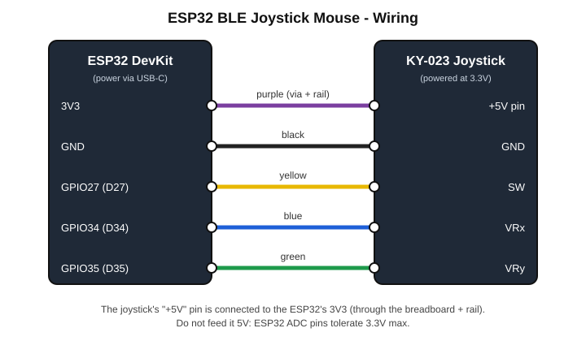

# ESP32 BLE Joystick Mouse

Mouse Bluetooth Low Energy (BLE) buatan sendiri berbasis ESP32 dan joystick analog KY-023. Perangkat ini terdeteksi sebagai mouse HID standar di komputer atau HP: joystick menggerakkan kursor, menekan joystick berfungsi sebagai klik kiri, dan tombol terpisah mengubah joystick menjadi kontrol scroll.


## Fitur

- Terdeteksi sebagai mouse BLE HID standar dengan nama **"ESP32 Mouse"**, tanpa driver tambahan
- Kalibrasi titik tengah joystick otomatis saat startup
- Deadzone untuk mencegah kursor bergeser sendiri
- Batas kecepatan per loop supaya gerakan halus dan tidak menyentak
- Klik kiri saat joystick ditekan
- Mode scroll: tahan tombol scroll lalu gerakkan joystick ke atas/bawah

## Perangkat Keras

| Komponen | Keterangan |
|----------|------------|
| ESP32 DevKit (USB-C) | Board ESP32 apa pun yang mendukung BLE |
| Modul joystick KY-023 | X/Y analog + tombol tekan |
| Tombol push (push button) | Untuk mode scroll, tanpa resistor eksternal |
| Breadboard + kabel jumper | |
| Kabel USB-C | Daya dari laptop, HP (USB-C ke USB-C), atau power bank |

## Wiring



| Pin KY-023 | Pin ESP32 | Warna kabel |
|------------|-----------|-------------|
| GND | GND | Hitam |
| +5V | 3V3 (lewat rail + breadboard) | Ungu |
| SW | GPIO27 (D27) | Kuning |
| VRx | GPIO34 (D34) | Biru |
| VRy | GPIO35 (D35) | Hijau |

| Pin tombol scroll | Pin ESP32 | Warna kabel |
|-------------------|-----------|-------------|
| Kaki 1 | GND | Hitam |
| Kaki 2 | GPIO26 (D26) | Oranye |

> **Penting:** beri daya joystick dari **3V3**, bukan 5V. Output analog joystick mengikuti tegangan suplainya, dan pin ADC ESP32 hanya tahan sampai 3,3V.

GPIO34 dan GPIO35 adalah pin ADC1 (input-only) yang tetap stabil saat BLE aktif. Tombol joystick (GPIO27) dan tombol scroll (GPIO26) memakai pull-up internal dan terbaca LOW saat ditekan.

<!-- Opsional: tambahkan foto rangkaian:  -->

## Perangkat Lunak

### Kebutuhan

- [Arduino IDE](https://www.arduino.cc/en/software) dengan board package **arduino-esp32** versi 3.x
- Library **NimBLE-Arduino** versi 2.3.8 atau lebih baru (dibutuhkan oleh library mouse)
- Library [HijelHID_BLEMouse](https://github.com/HijelHub/HijelHID_BLEMouse), bisa diinstal lewat Library Manager (cari "HijelHID") atau lewat file ZIP dari GitHub

### Upload

1. Clone repositori ini.
2. Buka `esp32_ble_joystick_mouse/esp32_ble_joystick_mouse.ino` di Arduino IDE.
3. Pilih board ESP32 dan port yang sesuai.
4. Klik **Upload**.

## Cara Pakai

1. Nyalakan ESP32 lewat USB-C.
2. **Biarkan joystick di posisi tengah (jangan disentuh) saat booting**, karena posisi diamnya dikalibrasi selama sekitar 0,5 detik pertama.
3. Di komputer atau HP, buka pengaturan Bluetooth lalu pairing dengan **ESP32 Mouse**.
4. Gerakkan joystick untuk menggerakkan kursor. Tekan joystick untuk klik kiri.
5. Untuk scroll, **tahan tombol scroll** lalu dorong joystick ke atas atau bawah. Selama tombol ditahan, joystick tidak menggerakkan kursor. Semakin jauh didorong, semakin cepat scroll-nya.

> Sumbu X/Y ditukar di kode agar sesuai orientasi joystick pada rangkaian ini (pin header di sisi kanan). Kalau arah kursor terbalik, ubah baris `deltaX` / `deltaY` di `loop()`.

## Konfigurasi

Ubah konstanta berikut di bagian atas sketch:

| Konstanta | Default | Fungsi |
|-----------|---------|--------|
| `deadzone` | `250` | Rentang nilai ADC di sekitar titik tengah yang diabaikan |
| `sensitivity` | `0.006` | Pengali kecepatan kursor |
| `maxSpeed` | `15` | Langkah kursor maksimum per loop |
| `scrollSensitivity` | `0.0015` | Pengali kecepatan scroll |
| `maxScrollTicks` | `3` | Jumlah tick scroll maksimum per pengiriman |
| `scrollIntervalMs` | `50` | Jeda minimum antar pengiriman scroll (ms) |

## Pemecahan Masalah

- **Kursor bergeser sendiri:** nyalakan ulang dengan joystick tidak disentuh, atau naikkan `deadzone`.
- **Arah gerakan salah:** ubah tanda atau tukar sumbu pada perhitungan `deltaX` / `deltaY`.
- **Arah scroll terbalik:** tukar tanda pada baris `mouse.scroll(...)` di `loop()`.
- **Tidak muncul di Bluetooth:** reset board, dan hapus pairing "ESP32 Mouse" lama dari perangkat.
- **Power bank mati sendiri:** sebagian power bank mati otomatis saat arus terlalu kecil. Coba power bank lain atau pakai laptop.

## Struktur Proyek

```
.
├── esp32_ble_joystick_mouse/
│   └── esp32_ble_joystick_mouse.ino
├── docs/
│   └── wiring-diagram.svg
└── README.md
```

## Lisensi

Tambahkan lisensi (misalnya MIT) lewat **Add file > Create new file > LICENSE** di GitHub.
