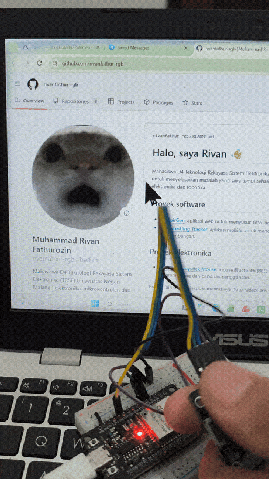

<a name="atas"></a>

# <sub></sub> ESP32 BLE Joystick Mouse

Mouse Bluetooth Low Energy (BLE) buatan sendiri berbasis ESP32 dan joystick analog KY-023. Perangkat ini terdeteksi sebagai mouse HID standar di komputer atau HP: joystick menggerakkan kursor, menekan joystick berfungsi sebagai klik kiri, dan tombol terpisah mengubah joystick menjadi kontrol scroll.



---

<details>
<summary> KLIK UNTUK DAFTAR ISI </summary>

* [Fitur](#fitur)
* [Perangkat Keras](#perangkat-keras)
* [Wiring](#wiring)
* [Cara Kerja](#cara-kerja)
* [Perangkat Lunak](#perangkat-lunak)
* [Cara Pakai](#cara-pakai)
* [Konfigurasi](#konfigurasi)
* [Pemecahan Masalah](#pemecahan-masalah)
* [Struktur Proyek](#struktur-proyek)
* [Lisensi](#lisensi)

</details>

---

<br>

## <a name="fitur"></a><sub></sub> Fitur

- Terdeteksi sebagai mouse BLE HID standar dengan nama **"ESP32 Mouse"**, tanpa driver tambahan
- Kalibrasi titik tengah joystick otomatis saat startup
- Deadzone untuk mencegah kursor bergeser sendiri
- Batas kecepatan per loop supaya gerakan halus dan tidak menyentak
- Klik kiri saat joystick ditekan (tahan untuk drag)
- Mode scroll: tahan tombol scroll lalu gerakkan joystick ke atas/bawah, makin jauh didorong makin cepat

[[Ke atas]](#atas)

---

<br>

## <a name="perangkat-keras"></a>Perangkat Keras

| Komponen | Keterangan |
|---|---|
| ESP32 DevKit (USB-C) | Board ESP32 apa pun yang mendukung BLE |
| Modul joystick KY-023 | X/Y analog + tombol tekan |
| Tombol push (push button) | Untuk mode scroll, tanpa resistor eksternal |
| Breadboard + kabel jumper | |
| Kabel USB-C | Daya dari laptop, HP (USB-C ke USB-C), atau power bank |

[[Ke atas]](#atas)

---

<br>

## <a name="wiring"></a>Wiring


| Pin KY-023 | Pin ESP32 | Warna kabel |
|---|---|---|
| GND | GND | Hitam |
| +5V (label di modul) | 3V3 (lewat rail + breadboard) | Ungu |
| SW | GPIO27 (D27) | Kuning |
| VRx | GPIO34 (D34) | Biru |
| VRy | GPIO35 (D35) | Hijau |

| Pin tombol scroll | Pin ESP32 | Warna kabel |
|---|---|---|
| Kaki 1 | GND | Hitam |
| Kaki 2 | GPIO26 (D26) | Oranye |

> [!IMPORTANT]
> Beri daya joystick dari **3V3**, bukan 5V. Output analog joystick mengikuti tegangan suplainya, dan pin ADC ESP32 hanya tahan sampai 3,3V.

> [!NOTE]
> GPIO34 dan GPIO35 adalah pin ADC1 (input-only) yang tetap stabil saat BLE aktif. Tombol joystick (GPIO27) dan tombol scroll (GPIO26) memakai pull-up internal, jadi terbaca LOW saat ditekan.

<!-- Opsional: tambahkan foto rangkaian:  -->

[[Ke atas]](#atas)

---

<br>

## <a name="cara-kerja"></a>Cara Kerja

1. Saat booting, 50 sampel pembacaan VRx dan VRy (sekitar 0,5 detik) dirata-rata sebagai titik tengah joystick.
2. Setelah terhubung lewat Bluetooth, tiap loop (sekitar 8 ms) nilai joystick dikurangi titik tengah. Selisih di bawah `deadzone` dianggap nol.
3. **Mode normal:** selisih dikali `sensitivity`, dibatasi `maxSpeed`, lalu dikirim sebagai gerakan mouse.
4. **Mode scroll (tombol scroll ditahan):** kursor diam dan hanya sumbu vertikal yang dipakai, dikirim sebagai tick scroll setiap `scrollIntervalMs`.
5. Menekan joystick mengirim klik kiri. Ditahan, tombol kiri ikut tertahan sehingga bisa dipakai untuk drag.

[[Ke atas]](#atas)

---

<br>

## <a name="perangkat-lunak"></a>Perangkat Lunak

### Kebutuhan

| Kebutuhan | Versi |
|---|---|
| [Arduino IDE](https://www.arduino.cc/en/software) | - |
| Paket board [esp32 by Espressif Systems](https://github.com/espressif/arduino-esp32) (arduino-esp32) | 3.x |
| [NimBLE-Arduino](https://github.com/h2zero/NimBLE-Arduino) | >= 2.3.8 |
| [HijelHID_BLEMouse](https://github.com/HijelHub/HijelHID_BLEMouse) | Terbaru |

Install paket board lewat `Tools → Board → Boards Manager`, cari "esp32".

Install NimBLE-Arduino lewat `Sketch → Include Library → Manage Libraries`, cari "NimBLE-Arduino".

### Install library HijelHID_BLEMouse

Library Manager: `Sketch → Include Library → Manage Libraries`, cari **"HijelHID"**

--- ATAU ---

Install manual lewat ZIP:
1. Unduh [ZIP terbaru](https://github.com/HijelHub/HijelHID_BLEMouse/releases/latest/download/HijelHID_BLEMouse.zip)
2. Di Arduino IDE: `Sketch → Include Library → Add .ZIP Library`
3. Pilih file ZIP yang diunduh

### Upload

1. Clone repositori ini.
2. Buka `esp32_ble_joystick_mouse/esp32_ble_joystick_mouse.ino` di Arduino IDE.
3. Pilih board ESP32 dan port yang sesuai.
4. Klik **Upload**.

[[Ke atas]](#atas)

---

<br>

## <a name="cara-pakai"></a>Cara Pakai

1. Nyalakan ESP32 lewat USB-C.
2. **Biarkan joystick di posisi tengah (jangan disentuh) saat booting**, karena posisi diamnya dikalibrasi selama sekitar 0,5 detik pertama.
3. Di komputer atau HP, buka pengaturan Bluetooth lalu pairing dengan **ESP32 Mouse**.
4. Gerakkan joystick untuk menggerakkan kursor. Tekan joystick untuk klik kiri.
5. Untuk scroll, **tahan tombol scroll** lalu dorong joystick ke atas atau bawah. Selama tombol ditahan, joystick tidak menggerakkan kursor.

> [!NOTE]
> Sumbu X/Y ditukar di kode agar sesuai orientasi joystick pada rangkaian ini (pin header di sisi kanan). Kalau arah kursor terbalik, ubah baris `deltaX` / `deltaY` di `loop()`.

[[Ke atas]](#atas)

---

<br>

## <a name="konfigurasi"></a><sub></sub> Konfigurasi

Ubah konstanta berikut di bagian atas sketch:

| Konstanta | Default | Fungsi |
|---|---|---|
| `deadzone` | `250` | Rentang nilai ADC di sekitar titik tengah yang diabaikan |
| `sensitivity` | `0.006` | Pengali kecepatan kursor |
| `maxSpeed` | `15` | Langkah kursor maksimum per loop |
| `scrollSensitivity` | `0.0015` | Pengali kecepatan scroll |
| `maxScrollTicks` | `3` | Jumlah tick scroll maksimum per pengiriman |
| `scrollIntervalMs` | `50` | Jeda minimum antar pengiriman scroll (ms) |

[[Ke atas]](#atas)

---

<br>

## <a name="pemecahan-masalah"></a><sub></sub> Pemecahan Masalah

**Kursor bergeser sendiri**
- Titik tengah hanya dikalibrasi sekali saat booting. Nyalakan ulang dengan joystick tidak disentuh
- Gunakan sumber daya USB yang stabil, atau naikkan `deadzone`

**Kursor tidak bergerak padahal sudah terhubung**
- Cek kabel VRx (GPIO34) dan VRy (GPIO35), pastikan joystick mendapat 3V3 dan GND
- Cek tombol scroll: kalau kakinya terhubung ke GND terus, perangkat terkunci di mode scroll

**Arah gerakan salah**
- Ubah tanda atau tukar sumbu pada perhitungan `deltaX` / `deltaY`

**Arah scroll terbalik**
- Tukar tanda pada baris `mouse.scroll(...)` di `loop()`

**Tidak muncul di Bluetooth**
- Reset board
- Hapus pairing "ESP32 Mouse" lama dari perangkat

**Power bank mati sendiri**
- Sebagian power bank mati otomatis saat arus terlalu kecil. Coba power bank lain atau pakai laptop

[[Ke atas]](#atas)

---

<br>

## <a name="struktur-proyek"></a>Struktur Proyek

```
.
├── esp32_ble_joystick_mouse/
│   └── esp32_ble_joystick_mouse.ino
├── Buat_Scroll_Ajah/
│   └── Buat_Scroll_Ajah.ino
├── docs/
│   ├── demo.gif
│   └── wiring-diagram.svg
├── LICENSE
└── README.md
```

[[Ke atas]](#atas)

---

## Bonus: Scroller 

Selain versi joystick di atas, repo ini juga bawa sketch `Buat_Scroll_Ajah.ino`: ESP32 + tombol yang jadi pengontrol scroll Bluetooth buat HP, supaya layar ga kena minyak waktu tangan lagi dipakai makan. Wiring-nya cuma tombol ke GPIO 4 dan GND, tanpa resistor tambahan. Tombolnya bisa diinjek pakai jempol kaki wkwkwk, tapi itu murni opsional (dan sangat disarankan kakinya bersih). Dibuat pakai library HijelHID_BLEMouse yang sama dengan proyek utama.

<br>

## <a name="lisensi"></a>Lisensi

Dirilis di bawah lisensi MIT. Lihat berkas [LICENSE](LICENSE).

---
